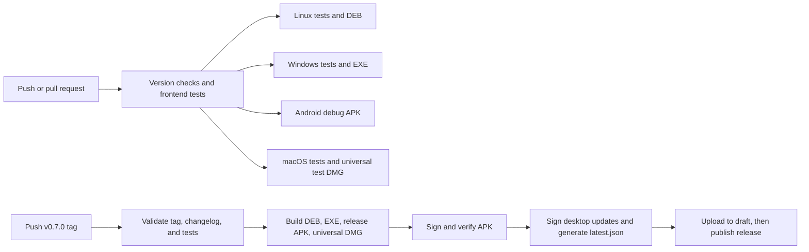

# Automatic GitHub releases

PulseDrop **v0.7.0** introduces in-app updates. Configure the updater signing secrets before pushing the tag. Earlier versions need a one-time manual installation of 0.7.0.

## What happens automatically



`.github/workflows/ci.yml` runs on pushes to `main`, pull requests, and manual dispatch. It checks all version files, type-checks JavaScript, runs JavaScript and desktop Rust tests, and builds Linux and Windows installers, an Android debug APK, and a universal macOS test DMG. Its artifacts are available on the workflow run for seven days. CI requires no signing secrets and never publishes a release.

`.github/workflows/release.yml` runs when you push a stable tag such as `v0.7.0`. The tag must match the versions in `package.json`, both lockfiles, `Cargo.toml`, and `tauri.conf.json`, and `CHANGELOG.md` must have a non-empty entry for that version. It tests and builds Linux, Windows, macOS, and Android, signs the Android release APK, signs and verifies desktop update packages, and generates the update feed before creating the GitHub Release. Assets are uploaded to a temporary draft, which the workflow publishes automatically after upload completes.

The Release page body contains **only the tagged version’s section** from `CHANGELOG.md`, extracted by `scripts/release-notes.mjs` and passed through GitHub CLI’s `--notes-file`. Missing, empty, or duplicate version headings fail validation. Draft retries use the same tagged section. Preview the body with `node scripts/release-notes.mjs 0.7.0`. See the [GitHub CLI release documentation](https://cli.github.com/manual/gh_release_create).

| Release asset | Architecture / platform |
| --- | --- |
| `PulseDrop_0.7.0_amd64.deb` | Linux x86-64, built on Ubuntu 24.04 |
| `PulseDrop_0.7.0_x64-setup.exe` | Windows x64 NSIS installer |
| `PulseDrop_0.7.0_android_arm64.apk` | Android ARM64 release APK, API 24+ |
| `PulseDrop_0.7.0_universal.dmg` | macOS Apple Silicon and Intel, experimental/ad hoc signed |
| `PulseDrop_0.7.0_universal.app.tar.gz` | App bundle used by the macOS updater |
| `latest.json` and `.sig` files | Update feed and desktop package signatures |
| `SHA256SUMS` | SHA-256 checksums for all packages |

The Linux build uses Ubuntu 24.04 as a baseline for compatibility with newer Ubuntu releases, including your Ubuntu 26.04 machine. The Windows job runs natively on `windows-2022`; it produces an `.exe` installer, rather than a standalone executable. The Windows installer has a PulseDrop update signature. Windows may still display an unknown-publisher prompt because the installer has no Authenticode certificate.

These are GitHub-hosted builds. The workflow installs its own toolchain and does not use the local `.build-tools/` directory. Android uses Java 21, API 36, and NDK 28.2.13676358, matching the local setup. Action references are pinned to commit hashes; update those pins when upgrading actions.

Windows setup caches Tauri’s installer tools in `%LOCALAPPDATA%\tauri`, keyed by runner architecture and the installed Tauri CLI version. CI and Release build desktop installers through `scripts/build-installer.mjs`. Windows NSIS builds retry up to three total attempts, waiting 10 then 20 seconds, only when the failed bundler log identifies a temporary HTTP download response (`408`, `429`, `500`, `502`, `503` or `504`). The helper streams build output, reuses compiled output/tools, and preserves Tauri’s download verification. Source errors, permanent HTTP errors, interruptions and exhausted retries still fail the job. Linux DEB builds run once.

## Download and test the macOS build

No personal Mac or Apple signing secrets are needed to build the ad hoc signed DMG. Both CI's **macOS universal test DMG** job and Release's **macOS universal DMG** job run on GitHub's `macos-15` runner, build the frontend before native Rust tests, and compile both Apple Silicon and Intel targets into one installer. They request `--bundles app,dmg` so Tauri retains the `.app` for verification; a DMG-only build removes that intermediate app after packaging. Each verifies the app's ad hoc signature, both executable architectures, the local network, camera and Location permission descriptions, and the DMG checksum before uploading the artifact.

Open [Actions → CI](https://github.com/shahabbai/PulseDrop/actions/workflows/ci.yml), select the latest successful run, and download **ci-macos-universal-dmg** from **Artifacts**. You can also use **Run workflow** on a branch containing the changes. Extract the downloaded ZIP and share the `.dmg` with a Mac tester. No new version or release tag is needed for this CI build.

For a published version, download the `.dmg` directly from [GitHub Releases](https://github.com/shahabbai/PulseDrop/releases). The release job builds it from the same tagged source as the other three installers; it does not reuse a previous CI artifact.

On the Mac, open the DMG, drag **PulseDrop** into **Applications**, and launch it. This test build uses ad hoc signing, not an Apple Developer identity, and is not notarized. Gatekeeper may block the first launch; for a build you trust, use **System Settings → Privacy & Security → Open Anyway**, then follow the confirmation prompts. See [Tauri's ad hoc signing guidance](https://v2.tauri.app/distribute/sign/macos/#ad-hoc-signing).

Allow PulseDrop's local network permission when prompted and allow incoming connections if the macOS firewall asks. Keep both apps open on the same LAN, then test discovery, manual IP/pairing, transfers in both directions with Ubuntu or Android, and **Open Inbox**. Declining local network access can prevent discovery and outgoing transfers; enable it in **System Settings → Privacy & Security → Local Network** if needed. The app includes `NSLocalNetworkUsageDescription` in its macOS bundle for this permission.

These jobs compile both architectures and run Rust tests on the runner's native architecture. They do not launch or test the graphical app, establish physical LAN connectivity, or build iOS. Apple Developer signing/notarization and physical device validation are separate follow-up work. The macOS download is experimental and ad hoc signed.

## 1. Create or reuse the Android release signing key

If you already have a production keystore, use that same file, alias, and passwords. Otherwise create one once. On this Ubuntu workspace:

```bash
source scripts/local-build-env.sh
mkdir -p .build-tools/signing
keytool -genkeypair -v \
  -keystore .build-tools/signing/pulsedrop-release.jks \
  -storetype JKS \
  -alias pulsedrop \
  -keyalg RSA -keysize 3072 -validity 10000
base64 -w 0 .build-tools/signing/pulsedrop-release.jks \
  > .build-tools/signing/pulsedrop-release.jks.base64
```

`keytool` prompts for the keystore password and certificate details, then the key password. You can choose the same password for the store and key. The Base64 file is an encoding of the private keystore, not encryption. Both files remain in the ignored `.build-tools/` directory.

Back up the keystore, alias, and passwords outside the repository. Reuse them for every release: Android requires the same signing identity when updating an installed app. The 0.1.0 APK built for your phone was debug-signed; switching it to a new release key requires a one-time uninstall/reinstall. Save any needed app data first. Later release APKs signed with this persistent release key can update one another normally. See [Android signing guidance](https://v2.tauri.app/distribute/sign/android/).

## 2. Add the Android and updater signing secrets

Open [PulseDrop Actions secrets](https://github.com/shahabbai/PulseDrop/settings/secrets/actions), or navigate to **Settings → Secrets and variables → Actions → New repository secret**. Add:

| Secret name | Value |
| --- | --- |
| `ANDROID_KEYSTORE_BASE64` | Entire contents of `pulsedrop-release.jks.base64` |
| `ANDROID_KEYSTORE_PASSWORD` | Keystore password |
| `ANDROID_KEY_ALIAS` | `pulsedrop`, or the alias in your existing keystore |
| `ANDROID_KEY_PASSWORD` | Key password; use the same value as the store password if configured that way |

Do not put these values in YAML or commit the keystore. The release workflow restores it in the runner's temporary directory, passes passwords through environment variables to `apksigner`, and removes the temporary keystore after signing. GitHub documents the secret setup [here](https://docs.github.com/en/actions/how-tos/write-workflows/choose-what-workflows-do/use-secrets).

If **Restore signing keystore** reports `Invalid base64-encoded string`, replace `ANDROID_KEYSTORE_BASE64` with the complete contents of the encoded file. A path, filename, partial selection, or a command is not the encoded keystore. Recreate the encoding from the existing key with:

```bash
base64 -w 0 .build-tools/signing/pulsedrop-release.jks \
  > .build-tools/signing/pulsedrop-release.jks.base64
```

Open that file locally, select/copy all its contents, and update the secret under **Settings → Secrets and variables → Actions**. Do not include quotes or Markdown formatting. Keep using the same keystore and passwords. After saving the corrected secret, open the failed Release run and choose **Re-run failed jobs**; a secret-only correction needs no new version tag or source commit. The updated workflow also validates Base64 before expensive build steps and accepts whitespace/line wrapping while rejecting malformed data. That workflow improvement applies to future tags containing the change; the existing tagged workflow works with the corrected single-line secret.

No personal access token is needed. The final publishing job requests `contents: write` for GitHub's automatically supplied `GITHUB_TOKEN`; other jobs use read access. If repository or organization policy disables Actions or restricts the referenced actions/token permissions, adjust that policy under **Settings → Actions → General**.

### Desktop updater signing

The updater key under `.build-tools/signing/` matches the public key in `src-tauri/tauri.conf.json`. Back up the private key and password together in a secure location. Keep the same key for future updates so installed copies can verify them.

Set the two repository secrets from the local files. With an authenticated GitHub CLI session, run:

```bash
gh secret set TAURI_SIGNING_PRIVATE_KEY < .build-tools/signing/pulsedrop-updater.key
gh secret set TAURI_SIGNING_PRIVATE_KEY_PASSWORD < .build-tools/signing/pulsedrop-updater.password
```

You can also enter the full contents of each file under **Settings → Secrets and variables → Actions**. The release job uses Minisign to sign the desktop packages and verifies each signature against the embedded public key. The signed version must match the version in `latest.json`.

## Test in-app updates

1. Install the published 0.7.0 DEB, Windows setup EXE, macOS app from the DMG, or signed Android APK. On macOS, copy the app to **Applications** first. On Android, keep the same release keystore.
2. Connect to the internet, stop the receiver and any hotspot session, then open **Settings → Software update → Check for updates**. When 0.7.0 is the latest release, the app should report that it is current.
3. After a newer version is published, repeat the check from 0.7.0. Watch the download progress and accept any system installer prompt. On Android, grant installation permission to PulseDrop if prompted, return to PulseDrop, and confirm in the system installer. Use **Install update** if you dismissed the prompt.
4. Open the updated app and verify the version under **Settings → About**, your saved theme, and a send and receive transfer. Repeat the check to confirm the new version is current.
5. During an active transfer or while connected to a PulseDrop hotspot, confirm that a check explains why it is paused. With the internet disconnected, confirm the update shows an error and can be retried after reconnecting.

## Future versions

For future releases, update the version and add a matching section to `CHANGELOG.md`. The version check and release notes preview can be run locally.

```bash
npm run version:bump -- 0.7.1
npm run version:check
node scripts/release-notes.mjs 0.7.1
```

`version:bump` updates the five manifest/lockfiles together. Android's default version code is derived from this version (`0.7.0` becomes `7000`), so increasing the version also increases the Android update version code. This setup accepts stable numeric versions only; prerelease suffixes need an explicit version-code policy before adding them.

## If a run fails

- If Windows reports `NonNull<c_void> cannot be sent between threads safely` through `NetworkOperatorTetheringManager` and `HotspotState`, the native manager was stored directly in Tauri's shared state. It now uses a Windows `AgileReference`, resolved in each initialized worker apartment, and a compile-time check enforces Tauri's `Send + Sync + 'static` state requirements even in the standalone Windows check. The accompanying `State is not an iterator` and missing hotspot-method errors are consequences of the same failed state bound. See [Microsoft's agile-reference guidance](https://learn.microsoft.com/en-us/windows/win32/api/combaseapi/nf-combaseapi-rogetagilereference).
- If Windows finishes compiling `pulse_drop.exe` but fails while downloading `nsis-3.11.zip` with `http status: 504`, the NSIS tool download timed out. Re-running the failed job may succeed once the download service recovers. New revisions use the installer-tool cache and bounded download retries in both CI and Release. A persistent outage still fails the build, so no incomplete installer is published.
- If native compilation reports that `kCLAuthorizationStatusAuthorizedWhenInUse` is unavailable on macOS, use the macOS authorization grant (`kCLAuthorizationStatusAuthorizedAlways`). The adapter reads the instance authorization property on macOS 11+ and retains the legacy getter only for older supported systems. Both macOS workflows run `bash scripts/check-macos-wifi.sh` against Apple Silicon and Intel deployment targets before Rust compilation so unavailable/deprecated SDK APIs fail in a named native check.
- If the macOS build succeeds but verification cannot find `PulseDrop.app/Contents/Info.plist`, ensure its build command uses `--bundles app,dmg`. Tauri removes the intermediate `.app` when only `dmg` is requested.
- A missing secret fails the Android release job with the secret names to configure. Add them, then use **Re-run failed jobs**.
- If Rust compilation reports that `frontendDist` (`../dist`) does not exist, build the frontend in that same job before `cargo test`. Desktop jobs do this explicitly because `tauri::generate_context!()` embeds frontend assets at compile time. The frontend built in the separate checks job is not shared with other runners.
- If Windows Rust tests hang at `cancelling_wakes_a_blocked_read_and_retains_the_response_channel`, update to the fix that uses short, cancellation-aware socket reads instead of relying on shutting down a cloned socket. The regression test now fails within a bounded wait. CI and Release compile Rust tests in a separate step, then limit test execution to five minutes so a hung test cannot consume the rest of the build job.
- A tag/version mismatch fails before building installers. Fix the source version and publish a new matching tag. Published versions should keep their original tags and assets.
- Failed builds do not reach the publishing job. A failure during upload leaves a draft; rerunning the publishing job reuses that draft and uploads the complete asset set before publication. Already published releases are not overwritten.
- Physical LAN discovery and transfer tests still belong in [device testing](device-testing.md); hosted runners verify builds and automated tests, not communication between your phone and PC.

The desktop build approach follows [Tauri's GitHub Actions guidance](https://v2.tauri.app/distribute/pipelines/github/).
