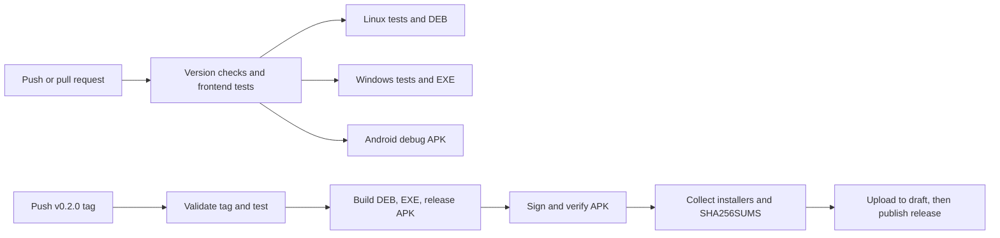

# Automatic GitHub releases

The next PulseDrop release is prepared as **0.2.0** because it adds LAN discovery and Linux support. The existing 0.1.0 build and `Release` tag can remain unchanged.

## What happens automatically



`.github/workflows/ci.yml` runs on pushes to `main`, pull requests, and manual dispatch. It checks all version files, runs JavaScript and desktop Rust tests, and builds Linux, Windows, and Android debug installers. Its artifacts are available on the workflow run for seven days. CI requires no signing secrets and never publishes a release.

`.github/workflows/release.yml` runs when you push a stable tag such as `v0.2.0`. The tag must match the versions in `package.json`, both lockfiles, `Cargo.toml`, and `tauri.conf.json`. It tests and builds every platform, signs the Android release APK, then creates a GitHub Release only after all builds succeed. Assets are uploaded to a temporary draft, which the workflow publishes automatically after upload completes.

| Release asset | Architecture / platform |
| --- | --- |
| `PulseDrop_0.2.0_amd64.deb` | Linux x86-64, built on Ubuntu 24.04 |
| `PulseDrop_0.2.0_x64-setup.exe` | Windows x64 NSIS installer |
| `PulseDrop_0.2.0_android_arm64.apk` | Android ARM64 release APK, API 24+ |
| `SHA256SUMS` | SHA-256 checksums for all three installers |

The Linux build uses Ubuntu 24.04 as a baseline for compatibility with newer Ubuntu releases, including your Ubuntu 26.04 machine. The Windows job runs natively on `windows-2022`; it produces an `.exe` installer, rather than a standalone executable. The Windows installer is currently unsigned, so Windows may show an unknown-publisher prompt. Windows certificate signing can be added separately.

These are GitHub-hosted builds. The workflow installs its own toolchain and does not use the local `.build-tools/` directory. Android uses Java 21, API 36, and NDK 28.2.13676358, matching the local setup. Action references are pinned to commit hashes; update those pins when upgrading actions.

## 1. Create or reuse the Android release signing key

If you already have a production keystore, use that same file, alias, and passwords. Otherwise create one once. On this Ubuntu workspace:

```bash
source scripts/local-build-env.sh
mkdir -p .build-tools/signing
keytool -genkeypair -v \
  -keystore .build-tools/signing/pulsedrop-release.jks \
  -storetype JKS \
  -alias pulsedrop \
  -keyalg RSA -keysize 3072 -validity 10000
base64 -w 0 .build-tools/signing/pulsedrop-release.jks \
  > .build-tools/signing/pulsedrop-release.jks.base64
```

`keytool` prompts for the keystore password and certificate details, then the key password. You can choose the same password for the store and key. The Base64 file is an encoding of the private keystore, not encryption. Both files remain in the ignored `.build-tools/` directory.

Back up the keystore, alias, and passwords outside the repository. Reuse them for every release: Android requires the same signing identity when updating an installed app. The 0.1.0 APK built for your phone was debug-signed; switching it to a new release key requires a one-time uninstall/reinstall. Save any needed app data first. Later release APKs signed with this persistent release key can update one another normally. See [Android signing guidance](https://v2.tauri.app/distribute/sign/android/).

## 2. Add four GitHub repository secrets

Open [PulseDrop Actions secrets](https://github.com/shahabbai/PulseDrop/settings/secrets/actions), or navigate to **Settings → Secrets and variables → Actions → New repository secret**. Add:

| Secret name | Value |
| --- | --- |
| `ANDROID_KEYSTORE_BASE64` | Entire contents of `pulsedrop-release.jks.base64` |
| `ANDROID_KEYSTORE_PASSWORD` | Keystore password |
| `ANDROID_KEY_ALIAS` | `pulsedrop`, or the alias in your existing keystore |
| `ANDROID_KEY_PASSWORD` | Key password; use the same value as the store password if configured that way |

Do not put these values in YAML or commit the keystore. The release workflow restores it in the runner's temporary directory, passes passwords through environment variables to `apksigner`, and removes the temporary keystore after signing. GitHub documents the secret setup [here](https://docs.github.com/en/actions/how-tos/write-workflows/choose-what-workflows-do/use-secrets).

No personal access token is needed. The final publishing job requests `contents: write` for GitHub's automatically supplied `GITHUB_TOKEN`; other jobs use read access. If repository or organization policy disables Actions or restricts the referenced actions/token permissions, adjust that policy under **Settings → Actions → General**.

## 3. Commit and push the source and workflow files

The discovery feature and build setup are currently local changes. The Android Gradle files and the shared composite action must be committed with the workflows so a clean runner has everything it needs.

```bash
npm run version:check
npm test
git add .github .gitignore CHANGELOG.md README.md docs scripts tests \
  src src-tauri package.json package-lock.json
git diff --cached --stat
git commit -m "Add LAN discovery and automated 0.2.0 releases"
git push origin main
```

Build outputs, local SDK/toolchains, and signing files are ignored. Open [Actions](https://github.com/shahabbai/PulseDrop/actions) and wait for **CI** to pass. The platform artifacts can be downloaded from the run to smoke-test installation before tagging. CI debug APKs are temporary test builds; use release APKs for updates that need a stable signing identity.

## 4. Publish version 0.2.0

After configuring the secrets and passing CI:

```bash
git tag -a v0.2.0 -m "PulseDrop 0.2.0"
git push origin v0.2.0
```

Pushing this tag starts **Release**. Once every job succeeds, GitHub automatically publishes [the release](https://github.com/shahabbai/PulseDrop/releases) with the `.deb`, `.apk`, `.exe`, checksums, and generated release notes. You do not need to upload installers by hand.

Pushing a commit alone runs CI. Pushing a matching version tag publishes that version. The workflows are prepared locally; no commit, tag, GitHub secret, or public release was created by this setup session.

## Future versions

For a bug fix, choose `0.2.1`; for another feature release, choose `0.3.0`. After committing the feature/fix, update the version and changelog:

```bash
npm run version:bump -- 0.2.1
# Update CHANGELOG.md with the release notes.
npm run version:check
git add package.json package-lock.json src-tauri/Cargo.toml \
  src-tauri/Cargo.lock src-tauri/tauri.conf.json CHANGELOG.md
git commit -m "Release 0.2.1"
git push origin main
# Wait for CI to pass, then:
git tag -a v0.2.1 -m "PulseDrop 0.2.1"
git push origin v0.2.1
```

`version:bump` updates the five manifest/lockfiles together. Android's default version code is derived from this version (`0.2.0` becomes `2000`), so increasing the version also increases the Android update version code. This setup accepts stable numeric versions only; prerelease suffixes need an explicit version-code policy before adding them.

## If a run fails

- A missing secret fails the Android release job with the secret names to configure. Add them, then use **Re-run failed jobs**.
- If Rust compilation reports that `frontendDist` (`../dist`) does not exist, build the frontend in that same job before `cargo test`. Desktop jobs do this explicitly because `tauri::generate_context!()` embeds frontend assets at compile time. The frontend built in the separate checks job is not shared with other runners. Commit/push workflow fixes to trigger a new CI run; rerunning an old run uses its original workflow revision.
- A tag/version mismatch fails before building installers. Fix the source version and publish a new matching tag. Published versions should keep their original tags and assets.
- Failed builds do not reach the publishing job. A failure during upload leaves a draft; rerunning the publishing job reuses that draft and uploads the complete asset set before publication. Already published releases are not overwritten.
- Physical LAN discovery and transfer tests still belong in [device testing](device-testing.md); hosted runners verify builds and automated tests, not communication between your phone and PC.

The desktop build approach follows [Tauri's GitHub Actions guidance](https://v2.tauri.app/distribute/pipelines/github/).

## Local validation of this setup

Workflow linting and pinned-action input checks passed, along with ten JavaScript tests covering discovery and version synchronization. The exact locked Linux release build command and the minified Android release build passed locally. Environment-based APK signing, signature verification, 16 KB alignment, and preserved bridge methods were checked with a temporary test key; that key was removed and is not a production signing identity. Publishing was tested with a mock GitHub CLI for new releases, draft retries, refusal to overwrite published releases, and upload failures that must not publish.

GitHub-hosted jobs, including the Windows installer build, have not been executed by this session. Their first run happens after you commit/push the workflows and configure the repository secrets.
