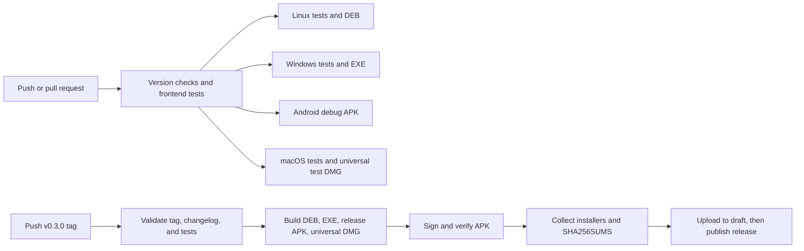

# Automatic GitHub releases

Use **v0.3.0** for the redesigned interface, live receiving progress, Android layout fixes, and macOS release download. This is a feature release after v0.2.0. A large visual change alone does not require declaring the app 1.0.0. Leave existing published tags unchanged.

The workflow and complete 0.3.0 changelog are prepared locally. Run the manual commands below to commit the features, update all version files to 0.3.0, push the commits, and finally push the tag. No commit, tag, or GitHub publication is performed by preparing these files.

## What happens automatically



`.github/workflows/ci.yml` runs on pushes to `main`, pull requests, and manual dispatch. It checks all version files, runs JavaScript and desktop Rust tests, and builds Linux and Windows installers, an Android debug APK, and a universal macOS test DMG. Its artifacts are available on the workflow run for seven days. CI requires no signing secrets and never publishes a release.

`.github/workflows/release.yml` runs when you push a stable tag such as `v0.3.0`. The tag must match the versions in `package.json`, both lockfiles, `Cargo.toml`, and `tauri.conf.json`, and `CHANGELOG.md` must have a non-empty entry for that version. It tests and builds Linux, Windows, macOS, and Android, signs the Android release APK, then creates a GitHub Release only after all release builds succeed. Assets are uploaded to a temporary draft, which the workflow publishes automatically after upload completes.

The Release page body comes directly from the entire `CHANGELOG.md` in the tagged commit using GitHub CLI's `--notes-file`. It includes the detailed new-version entry and all previous entries. Draft retries refresh those notes from the same tagged file. Edit the changelog before committing and tagging; autogenerated commit summaries are no longer used as the release body. See the [GitHub CLI release documentation](https://cli.github.com/manual/gh_release_create).

| Release asset | Architecture / platform |
| --- | --- |
| `PulseDrop_0.3.0_amd64.deb` | Linux x86-64, built on Ubuntu 24.04 |
| `PulseDrop_0.3.0_x64-setup.exe` | Windows x64 NSIS installer |
| `PulseDrop_0.3.0_android_arm64.apk` | Android ARM64 release APK, API 24+ |
| `PulseDrop_0.3.0_universal.dmg` | macOS Apple Silicon and Intel, experimental/ad hoc signed |
| `SHA256SUMS` | SHA-256 checksums for all four installers |

The Linux build uses Ubuntu 24.04 as a baseline for compatibility with newer Ubuntu releases, including your Ubuntu 26.04 machine. The Windows job runs natively on `windows-2022`; it produces an `.exe` installer, rather than a standalone executable. The Windows installer is currently unsigned, so Windows may show an unknown-publisher prompt. Windows certificate signing can be added separately.

These are GitHub-hosted builds. The workflow installs its own toolchain and does not use the local `.build-tools/` directory. Android uses Java 21, API 36, and NDK 28.2.13676358, matching the local setup. Action references are pinned to commit hashes; update those pins when upgrading actions.

## Download and test the macOS build

No personal Mac or Apple signing secrets are needed to build the ad hoc signed DMG. Both CI's **macOS universal test DMG** job and Release's **macOS universal DMG** job run on GitHub's `macos-15` runner, build the frontend before native Rust tests, and compile both Apple Silicon and Intel targets into one installer. They request `--bundles app,dmg` so Tauri retains the `.app` for verification; a DMG-only build removes that intermediate app after packaging. Each verifies the app's ad hoc signature, both executable architectures, the local network permission description, and the DMG checksum before uploading the artifact.

After committing/pushing the CI changes, open [Actions → CI](https://github.com/shahabbai/PulseDrop/actions/workflows/ci.yml), select the latest successful run, and download **ci-macos-universal-dmg** from **Artifacts**. You can also use **Run workflow** on a branch containing the changes. Extract the downloaded ZIP and share the `.dmg` with a Mac tester. No new version or release tag is needed for this CI build.

For a published version, download the `.dmg` directly from [GitHub Releases](https://github.com/shahabbai/PulseDrop/releases). The release job builds it from the same tagged source as the other three installers; it does not reuse a previous CI artifact.

On the Mac, open the DMG, drag **PulseDrop** into **Applications**, and launch it. This test build uses ad hoc signing, not an Apple Developer identity, and is not notarized. Gatekeeper may block the first launch; for a build you trust, use **System Settings → Privacy & Security → Open Anyway**, then follow the confirmation prompts. See [Tauri's ad hoc signing guidance](https://v2.tauri.app/distribute/sign/macos/#ad-hoc-signing).

Allow PulseDrop's local network permission when prompted and allow incoming connections if the macOS firewall asks. Keep both apps open on the same LAN, then test discovery, manual IP/pairing, transfers in both directions with Ubuntu or Android, and **Open Inbox**. Declining local network access can prevent discovery and outgoing transfers; enable it in **System Settings → Privacy & Security → Local Network** if needed. The app includes `NSLocalNetworkUsageDescription` in its macOS bundle for this permission.

These jobs compile both architectures and run Rust tests on the runner's native architecture. They do not launch or test the graphical app, establish physical LAN connectivity, or build iOS. Apple Developer signing/notarization and physical device validation are separate follow-up work. The release notes explicitly identify the macOS download as experimental and not notarized.

## 1. Create or reuse the Android release signing key

If you already have a production keystore, use that same file, alias, and passwords. Otherwise create one once. On this Ubuntu workspace:

```bash
source scripts/local-build-env.sh
mkdir -p .build-tools/signing
keytool -genkeypair -v \
  -keystore .build-tools/signing/pulsedrop-release.jks \
  -storetype JKS \
  -alias pulsedrop \
  -keyalg RSA -keysize 3072 -validity 10000
base64 -w 0 .build-tools/signing/pulsedrop-release.jks \
  > .build-tools/signing/pulsedrop-release.jks.base64
```

`keytool` prompts for the keystore password and certificate details, then the key password. You can choose the same password for the store and key. The Base64 file is an encoding of the private keystore, not encryption. Both files remain in the ignored `.build-tools/` directory.

Back up the keystore, alias, and passwords outside the repository. Reuse them for every release: Android requires the same signing identity when updating an installed app. The 0.1.0 APK built for your phone was debug-signed; switching it to a new release key requires a one-time uninstall/reinstall. Save any needed app data first. Later release APKs signed with this persistent release key can update one another normally. See [Android signing guidance](https://v2.tauri.app/distribute/sign/android/).

## 2. Add four GitHub repository secrets

Open [PulseDrop Actions secrets](https://github.com/shahabbai/PulseDrop/settings/secrets/actions), or navigate to **Settings → Secrets and variables → Actions → New repository secret**. Add:

| Secret name | Value |
| --- | --- |
| `ANDROID_KEYSTORE_BASE64` | Entire contents of `pulsedrop-release.jks.base64` |
| `ANDROID_KEYSTORE_PASSWORD` | Keystore password |
| `ANDROID_KEY_ALIAS` | `pulsedrop`, or the alias in your existing keystore |
| `ANDROID_KEY_PASSWORD` | Key password; use the same value as the store password if configured that way |

Do not put these values in YAML or commit the keystore. The release workflow restores it in the runner's temporary directory, passes passwords through environment variables to `apksigner`, and removes the temporary keystore after signing. GitHub documents the secret setup [here](https://docs.github.com/en/actions/how-tos/write-workflows/choose-what-workflows-do/use-secrets).

If **Restore signing keystore** reports `Invalid base64-encoded string`, replace `ANDROID_KEYSTORE_BASE64` with the complete contents of the encoded file. A path, filename, partial selection, or a command is not the encoded keystore. Recreate the encoding from the existing key with:

```bash
base64 -w 0 .build-tools/signing/pulsedrop-release.jks \
  > .build-tools/signing/pulsedrop-release.jks.base64
```

Open that file locally, select/copy all its contents, and update the secret under **Settings → Secrets and variables → Actions**. Do not include quotes or Markdown formatting. Keep using the same keystore and passwords. After saving the corrected secret, open the failed Release run and choose **Re-run failed jobs**; a secret-only correction needs no new version tag or source commit. The updated workflow also validates Base64 before expensive build steps and accepts whitespace/line wrapping while rejecting malformed data. That workflow improvement applies to future tags containing the change; the existing tagged workflow works with the corrected single-line secret.

No personal access token is needed. The final publishing job requests `contents: write` for GitHub's automatically supplied `GITHUB_TOKEN`; other jobs use read access. If repository or organization policy disables Actions or restricts the referenced actions/token permissions, adjust that policy under **Settings → Actions → General**.

## 3. Commit the features manually

Run these commands from the repository root on `main`. First check `git diff --cached --name-only`; review any already staged changes before committing. The commands below use explicit file lists. `design-system/`, `.agents/`, `.codex/`, build artifacts, local tools, and signing files are ignored, and none are included in these lists. No design reference is required by the build, and the README no longer links to the excluded design directory.

### Release automation and local exclusions

```bash
git add .gitignore .github/workflows/release.yml docs/github-releases.md
git diff --cached --stat
git commit -m "ci: publish macOS installers and full release changelog"
```

### Native receiving progress and safe file saving

```bash
git add src-tauri/src/lib.rs src-tauri/src/receive.rs docs/receive-progress.md
git diff --cached --stat
git commit -m "feat: report receiving progress and clean up incomplete uploads"
```

### Redesigned interface and receiving progress views

The UI redesign and receiving progress share `src/main.js`, `src/index.html`, and `src/styles.css`, so commit their frontend changes together. The native change above can operate with the previous completion-only UI; this frontend consumes the additional progress events.

```bash
git add src/index.html src/main.js src/styles.css src/ui.js src/receive-progress.js \
  tests/ui.test.mjs tests/receive-progress.test.mjs src-tauri/tauri.conf.json
git diff --cached --stat
git commit -m "feat: redesign the interface and display live receiving progress"
```

### Android system-bar and keyboard layout fix

```bash
git add src-tauri/gen/android/app/src/main/AndroidManifest.xml \
  src-tauri/gen/android/app/src/main/java/com/pulsedrop/transfer/MainActivity.kt \
  src-tauri/gen/android/app/src/main/res/values/themes.xml \
  src-tauri/gen/android/app/src/main/res/values-night/themes.xml \
  src-tauri/gen/android/app/src/main/res/values/colors.xml
git diff --cached --stat
git commit -m "fix(android): respect system bars, cutouts, and keyboard insets"
```

### Version, changelog, and public documentation

The version command updates all five manifests/lockfiles together. Run it after the frontend commit so that the window configuration and version bump remain separate changes.

```bash
npm run version:bump -- 0.3.0
npm run version:check -- v0.3.0
npm test
npm run frontend:build
git add package.json package-lock.json src-tauri/Cargo.toml \
  src-tauri/Cargo.lock src-tauri/tauri.conf.json CHANGELOG.md README.md docs/device-testing.md
git diff --cached --stat
git commit -m "chore: prepare PulseDrop 0.3.0"
git status --short
git push origin main
```

Open [Actions → CI](https://github.com/shahabbai/PulseDrop/actions/workflows/ci.yml) and wait for the run on the final release commit to pass. Its platform artifacts can be downloaded to smoke-test installation before tagging. CI debug APKs are temporary test builds; the tag workflow builds a fresh APK with the existing release signing key.

## 4. Publish version 0.3.0

After the final commit passes CI, with your existing Android secrets still configured:

```bash
git tag -a v0.3.0 -m "PulseDrop 0.3.0"
git push origin v0.3.0
```

Pushing this tag starts **Release**. Once every job succeeds, GitHub automatically publishes [the release](https://github.com/shahabbai/PulseDrop/releases) with the `.deb`, `.apk`, `.exe`, `.dmg`, checksums, and the entire `CHANGELOG.md` as its visible release notes. No installer needs to be uploaded or committed by hand. The APK is ARM64, the Windows and Linux packages are x64, and the DMG contains both macOS architectures.

Pushing a commit alone runs CI. Pushing the matching version tag publishes the release. An existing published tag must not be reused or moved.

## Future versions

After 0.3.0, use `0.3.1` for fixes or `0.4.0` for another feature release. After committing the feature/fix, update the version and changelog:

```bash
npm run version:bump -- 0.3.1
# Update CHANGELOG.md with the release notes.
npm run version:check
git add package.json package-lock.json src-tauri/Cargo.toml \
  src-tauri/Cargo.lock src-tauri/tauri.conf.json CHANGELOG.md
git commit -m "Release 0.3.1"
git push origin main
# Wait for CI to pass, then:
git tag -a v0.3.1 -m "PulseDrop 0.3.1"
git push origin v0.3.1
```

`version:bump` updates the five manifest/lockfiles together. Android's default version code is derived from this version (`0.3.0` becomes `3000`), so increasing the version also increases the Android update version code. This setup accepts stable numeric versions only; prerelease suffixes need an explicit version-code policy before adding them.

## If a run fails

- If the macOS build succeeds but verification cannot find `PulseDrop.app/Contents/Info.plist`, ensure its build command uses `--bundles app,dmg`. Tauri removes the intermediate `.app` when only `dmg` is requested. Commit and push the workflow fix to start a new CI run; rerunning the previous run uses the old command.
- A missing secret fails the Android release job with the secret names to configure. Add them, then use **Re-run failed jobs**.
- If Rust compilation reports that `frontendDist` (`../dist`) does not exist, build the frontend in that same job before `cargo test`. Desktop jobs do this explicitly because `tauri::generate_context!()` embeds frontend assets at compile time. The frontend built in the separate checks job is not shared with other runners. Commit/push workflow fixes to trigger a new CI run; rerunning an old run uses its original workflow revision.
- A tag/version mismatch fails before building installers. Fix the source version and publish a new matching tag. Published versions should keep their original tags and assets.
- Failed builds do not reach the publishing job. A failure during upload leaves a draft; rerunning the publishing job reuses that draft and uploads the complete asset set before publication. Already published releases are not overwritten.
- Physical LAN discovery and transfer tests still belong in [device testing](device-testing.md); hosted runners verify builds and automated tests, not communication between your phone and PC.

The desktop build approach follows [Tauri's GitHub Actions guidance](https://v2.tauri.app/distribute/pipelines/github/).

## Local validation of this setup

For the 0.3.0 release changes, workflow linting, frontend tests/build, ignored-file checks, and the complete manual commit file lists passed. The version bump was checked in a temporary copy; the workspace manifests are intentionally left at 0.2.0 until the manual version command above. Mock GitHub CLI checks verified full-changelog publication for a new release and draft retry, refusal to modify an already published release, and no publication after a failed asset upload. Asset checks rejected missing, duplicate, and wrong-version installers, including the DMG, and validated checksums for all four files. The changelog check rejected missing and empty version entries. No GitHub service was contacted by these checks.

Workflow linting and pinned-action input checks passed, along with ten JavaScript tests covering discovery and version synchronization. The exact locked Linux release build command and the minified Android release build passed locally. Environment-based APK signing, signature verification, 16 KB alignment, and preserved bridge methods were checked with a temporary test key; that key was removed and is not a production signing identity. Publishing was tested with a mock GitHub CLI for new releases, draft retries, refusal to overwrite published releases, and upload failures that must not publish.

GitHub-hosted jobs, including the Windows installer build, have not been executed by this session. Their first run happens after you commit/push the workflows and configure the repository secrets.
